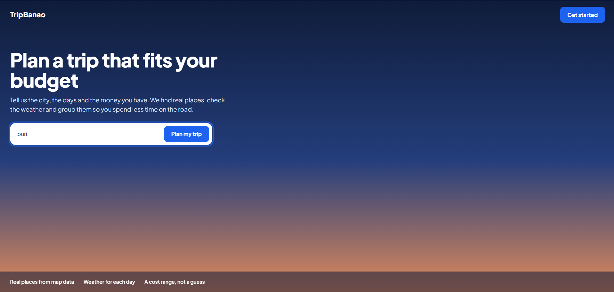
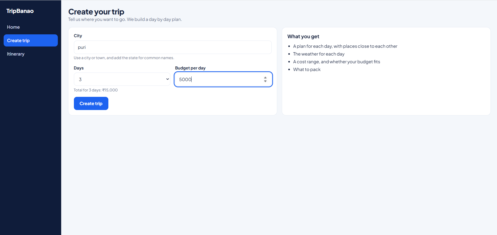
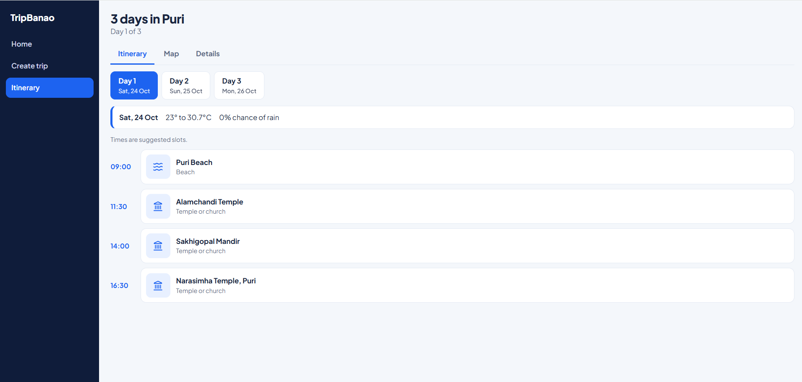
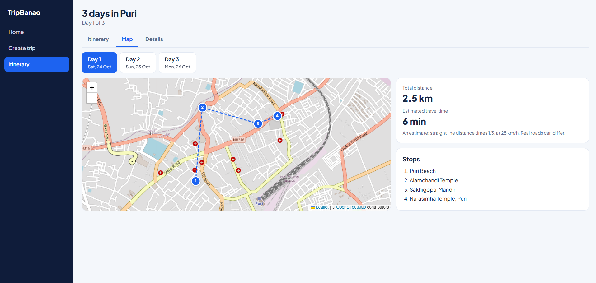
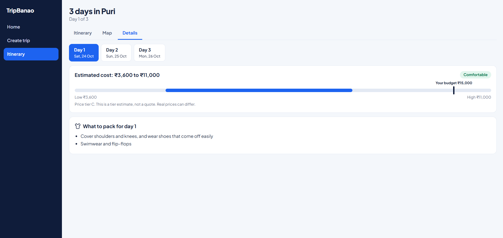

# TripBanao (frontend)

TripBanao builds a day by day trip plan from a city name. This is the React frontend: you enter a city, the number of days, and a budget, and it shows the plan with the weather, places on a map, a packing list, and an estimated cost range.

Backend repo: https://github.com/Kiran08-in/your-backend-repo

## Screenshots






## Features

- Landing page with a quick search
- Create trip form with validation, a loading screen, and clear error messages (city not found, wrong input, service busy, server not reachable)
- Itinerary with a tab for each section: Itinerary, Map, and Details
- Day buttons, and the weather for each day
- Map with numbered pins, a line between the stops, and an estimated distance and travel time
- Cost range with a verdict ("likely not enough", "may fit", or "comfortable") and a note that it is an estimate
- Packing list for each day
- The last trip is kept while the browser tab is open
- Responsive layout for phones

## Tech stack

React, Vite, React Router, Leaflet (react-leaflet), lucide-react icons, and plain CSS with CSS variables.

## How to run

The backend must be running at `http://127.0.0.1:8000` first (see the backend README).

```
npm install
npm run dev
```

Open http://localhost:5173

## Project structure

```
src/
  api/client.js      all backend calls in one place
  components/        Sidebar, AppLayout, WeatherBar, PlaceCard, CostCard, PackingCard, MapView
  pages/             Home, Plan, Itinerary
  utils/             format.js (dates, money), geo.js (distance)
  App.jsx            the routes
  index.css          styles and colour variables
```

## Notes and limits

- The cost is an **estimate** from price tiers, and not a real quote.
- Travel time is an estimate (straight line distance times 1.3, at 25 km/h).
- Map tiles and data are from OpenStreetMap contributors.
- Places come from the backend, and small towns may have few places.

## Planned for version 2

AI assistant to change the plan by chat, local travel tips, saved trips and login, place photos, road routes on the map, and richer weather.